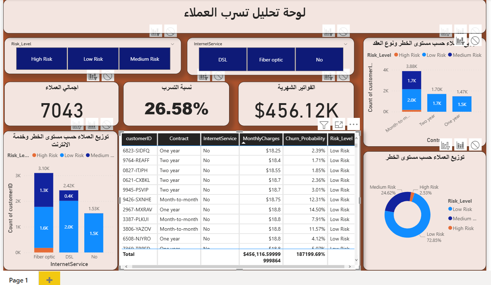

# 📊 مشروع التنبؤ بتسرب عملاء الاتصالات (Telco Customer Churn Prediction & Power BI Dashboard)

## 📌 نظرة عامة على المشروع (Project Overview)
يهدف هذا المشروع إلى دراسة سلوك عملاء شركة اتصالات والتنبؤ بالعملاء المعرضين لإلغاء الخدمة (Churn) باستخدام تقنيات التعلم الآلي (Random Forest)، ثم تقديم لوحة تحكم تفاعلية عبر Power BI لتمكين فريق المبيعات والتسويق من اتخاذ قرارات استبقاء استراتيجية.

---

## 🎯 المشكلة التجارية (Business Problem)
تكلفة اكتساب عميل جديد تعادل 5 أضعاف تكلفة الحفاظ على عميل حالي. تسعى الشركة إلى تحديد العملاء الأكثر عرضة للمغادرة وتحديد الأسباب الرئيسية وراء ذلك للتدخل المبكر بتقليل معدل الفقد وحماية الإيرادات الشهرية.

---

## 🛠️ أدوات وتقنيات العمل (Tech Stack)
* **Python**: (Pandas, NumPy, Scikit-Learn, Matplotlib)
* **Machine Learning**: Random Forest Classifier
* **Business Intelligence**: Power BI
* **Version Control**: Git & GitHub

---

## 📈 نتائج نموذج التعلم الآلي (ML Model Performance)
تم تدريب نموذج **Random Forest** بنجاح وحقق النتائج التالية على بيانات الاختبار:
* **الدقة العامة (Accuracy):** 79.35%
* **مقياس التمييز (ROC-AUC Score):** 0.8418

---

## 🖥️️ لوحة التحكم التفاعلية (Power BI Dashboard)


### أبرز الرؤى والاستنتاجات (Key Insights):
1. **أعلى شريحة خطر:** العملاء المشتركون في **العقود الشهرية (Month-to-month)** يعانون من أعلى معدل تسرب مقارنة بالعقود السنوية.
2. **نوع الخدمة:** خدمة **Fiber Optic** تسجل أعلى نسبة مخاطر تسرب، مما يشير إلى وجود مشاكل جودة أو ارتفاع في الأسعار.
3. **الأثر المالي:** يتركز خطر الخسارة المالية في العملاء ذوي الفواتير الشهرية مرتفعة السعر.

---

## 💡 التوصيات التجارية (Business Recommendations)
* تقديم خصومات تشجيعية تحث عملاء العقود الشهرية على التحويل إلى عقود سنوية.
* مراجعة جودة وأسعار خدمة الألياف الضوئية (Fiber Optic).
* توجيه حملات الاستبقاء المباشرة للعملاء المصنفين في شريحة **High Risk** (احتمالية تسرب > 70%).

---

## 🚀 كيفية تشغيل المشروع (How to Run)
1. قم بتنزيل المشروع
   ```bash
   git clone [https://github.com/firas44446/telco-churn-prediction.git](https://github.com/firas44446/telco-churn-prediction.git)

2. تشغيل كود Jupyter Notebook لاستخراج التنبؤات.

3. فتح ملف .pbix عبر Power BI Desktop لاستعراض الداشبورد.   